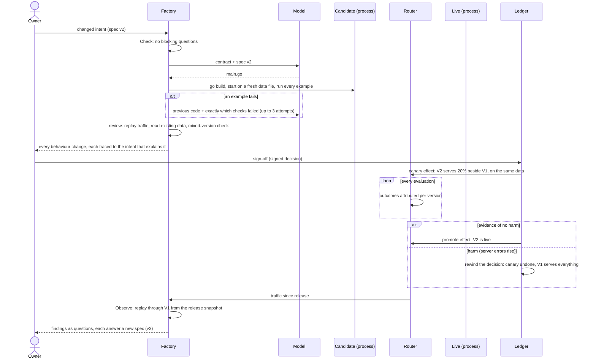
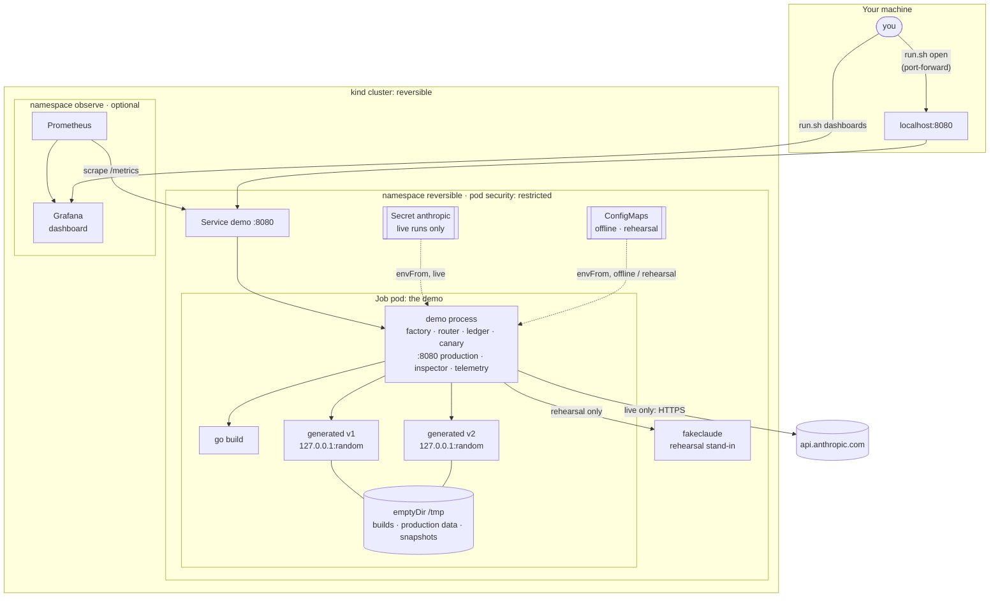

# Architecture

This repo is a working prototype of one idea: **software is built from intent**. People say what they want; that becomes a precise spec; code is generated from the spec and treated as a cache; changes are judged by how behaviour changes on real traffic and data, not by reading diffs; releases are undoable decisions in a signed ledger; and what production does flows back as questions whose answers are new intent.

This document describes how the pieces fit together when the system actually runs: first the logical architecture, then exactly what runs where in the kind environment (`deploy/kind`), then what a production deployment would need that isn't built yet. Domains in the demos (feature flags, incidents) are examples; nothing described here depends on them.

For how to operate it, see [USER-GUIDE.md](USER-GUIDE.md). For what leaves your machine when a model is involved, see [RUNNING-WITH-CLAUDE.md](RUNNING-WITH-CLAUDE.md).

## The loop

A person appears at four points only: stating intent, answering questions, signing off on behaviour, and answering production's questions. Everything between is mechanical, and every mechanical step either passes evidence forward or stops.

## Components

| Component | Package | What it does | State it keeps |
|---|---|---|---|
| **Spec** | `factory` (`spec.go`) | The source of truth: resources, fields, references, lifecycles (`transitions`), filters, writers, rules, and examples that are the contract. `Check` returns blocking and clarifying questions; nothing blocked is built. A spec's hash names everything built from it. | None (it's data) |
| **Capture** | `factory` (`capture.go`) | Asks a model to turn a conversation (plus the current spec, if any) into a spec and its own questions. The reply is parsed strictly and then checked like any other spec. | None |
| **Coder** | `factory` (`codegen.go`, `coder.go`) | Writes `main.go` from the spec. `Codegen` is a deterministic compiler (offline); `ModelCoder` asks a model, and on failure sends back its previous code and exactly which checks failed. | None |
| **Factory** | `factory` (`factory.go`, `build.go`) | Builds the code with `go build` (standard library only, no network), starts it as a separate process, runs every example in order against a fresh instance, retries the coder up to three times. Caches each build by spec hash. | `builds/<spec hash>/` |
| **Generated service** | output | A small HTTP service meeting a fixed contract: listens on `ADDR`, prints `LISTENING <url>`, keeps state in the JSON file at `DATA`, reads it on every request, preserves fields and resources it doesn't know (so two versions can share data), and treats the `X-Caller` header as the caller's identity. | The `DATA` file |
| **Router** | `factory` (`router.go`) | Production's front door. Forwards each request to the live version, or to a canary for a share of requests, and records every exchange (request, response, serving version, latency). Snapshots the data at each release. | Traffic log (memory), data snapshots |
| **Review** | `factory` (`diff.go`, `mixed.go`, `canary.go`) | Before release: replays all recorded traffic through both versions; reads every existing record through both; runs both on the same data to check neither destroys the other's fields. Every difference is explained by a specific intent change ("new access rule: only on-call may change incidents") or flagged as unexplained, which blocks sign-off. | None |
| **Canary** | `factory` (`canary.go`) + `evolve` | Runs the candidate beside the live version on a share of real traffic (20% in the demos, assigned by salted SHA-256 so it's stable and uncorrelated). Each outcome is attributed to the version that served it. A sequential test with alpha spending (6α/π²k²) promotes on evidence of no harm, or retires the candidate and rewinds the decision behind it when server errors rise. | Per-version outcomes |
| **Observe / Propose** | `factory` (`observe.go`) | After a release, replays every request since then through the previous version, starting from the release snapshot. New refusals and server errors become findings, grouped by caller and traced to the intent change behind them. Each finding becomes a question with concrete answers (keep refusing, exempt the caller, grant access, allow the transition, drop the rule), and each answer is a new spec that includes the production request as an example. | None |
| **Decision ledger** | `decision` | Goals, decisions, outcomes and the effects executed under them, as a graph. Every record is signed with the ed25519 key of the actor responsible and hash-chained to the previous one. `Explain` answers "why is this live?"; `Rewind` undoes a decision and everything downstream of it. | Records (pluggable `decision.Log`) |
| **Effect runtime** | `reversible` (root package) | Every change to the world (a release, a canary, a promotion) is an effect declared with its inverse. Intents run to completion or roll back, with crash recovery and idempotency. | Effect journal |
| **Model client** | `model` | Calls the Messages API with the standard library. 16,000-token replies by default (`REVERSIBLE_MAX_TOKENS`); a reply cut off at the limit is an error, never parsed as complete; 429, 5xx and network errors are retried with backoff; token usage is logged per call and totalled. | Usage counters |
| **Inspector** | `cmd/internal/serve` | Serves production, `/_factory/` (what's live and why, the spec, the examples and what the live version answered, recent traffic, the generated code) and telemetry, from the start of a run. `/_factory/ready` turns 200 once the story is over. | None |
| **Telemetry** | `telemetry` | Prometheus metrics (`/metrics`) and a stream of structured events (`/_factory/events`, optionally to a file) from every step: specs checked, builds and attempts, model calls, reviews, routing changes, canary evaluations, findings and ledger records. A live view (`/_factory/live`) follows both. | Metrics, the last 2,000 events |

## The life of a change

Three properties hold throughout:

- **Nothing reaches production without evidence.** Examples, then the review, then a canary judged by statistics. A step that can't produce its evidence stops the change.
- **Every change is undoable by construction.** Releases, canaries and promotions are effects with inverses, executed under decisions. Rewinding a decision undoes its effects in reverse order; the data stays where it is, because every version reads data written by any other.
- **Code is never the thing reviewed or kept.** It's regenerated whenever intent changes and cached by spec hash; reaffirming an old intent is served from the cache with nothing regenerated.

## Running in kind

`deploy/kind/run.sh up` creates a one-node kind cluster named `reversible` with Calico as its network plugin (so NetworkPolicy is enforced), builds the image and loads it, and applies the namespace, network rules and rehearsal stand-in. A demo run is a Kubernetes Job; its pod runs the whole story, then keeps serving.

**Inside the pod** there is one container and a tree of processes:

- PID 1 is the demo binary (`incidents` or `factory`). It holds the factory, the router, the canary, the decision ledger and telemetry, all in memory, and serves production, the inspector and telemetry on `:8080` from the start.
- For each version of the intent it runs `go build` in `/tmp/<demo>-demo-*/builds/<spec hash>/` (standard library only; `GOPROXY=off` makes module downloads impossible), then starts the binary as a child process on `127.0.0.1` with a random port. During a canary two versions run side by side, sharing one data file. Examples, replays and mixed-version checks start further short-lived instances on scratch data.
- Production data is `/tmp/<demo>-demo-*/production/<service>.json`, with a snapshot per release beside it.

**The three modes** differ only in what's injected and what the network allows:

| Mode | Coder | Environment | Network (NetworkPolicy) |
|---|---|---|---|
| `offline` | Deterministic generator | ConfigMap `offline` (no key) | None at all, not even DNS |
| `rehearse` | `ModelCoder`, answered by `cmd/fakeclaude` with the generator's code | ConfigMap `rehearsal`: a fake key and `ANTHROPIC_BASE_URL=http://fakeclaude...` | DNS, and only the `fakeclaude` pod on 8080 |
| `live` | Claude writes the code (`incidents`), or drafts the specs and writes the code (`factory`) | Secret `anthropic`, plus `REVERSIBLE_MODEL` | DNS, and TCP 443 to public addresses only (private, link-local and CGNAT ranges excluded, so not the cluster, the node or your LAN) |

`run.sh check` starts a pod in each network mode and proves the rules hold on this cluster, using `cmd/reach` (a TCP connect probe): offline reaches nothing; live reaches the Anthropic API but not the Kubernetes API. Don't run live if it fails. kind's default CNI doesn't enforce NetworkPolicy (the first CI run of `check` showed an offline pod reaching the internet), so the cluster is created without it and `up` installs Calico, which does. `check` exists so this is never taken on trust.

**The pod's security context:** non-root (uid 65532), read-only root filesystem, all capabilities dropped, no privilege escalation, RuntimeDefault seccomp, no service-account token mounted, no service-link environment variables, CPU/memory/disk limits, and a two-hour deadline. Writable space is two size-limited `emptyDir` volumes (`/work` for HOME and the Go build cache, `/tmp` for everything the factory produces).

**Getting in:** `kubectl port-forward` to the `demo` Service. Port-forwarding doesn't pass through NetworkPolicy. Inside the cluster only Prometheus can reach the pod, on its HTTP port, when `run.sh observe` has been run.

**The CI job `kind`** runs this whole path on every push: up, the isolation check, an offline run used through a port-forward, and a rehearsal that includes a retried overload. No key is used in CI.

## State: where it lives, what survives

| State | Where | Survives pod deletion? |
|---|---|---|
| Intent (specs) | Embedded in the image (`cmd/<demo>/intent/*.json`); live, the factory demo's specs are drafted in memory | Offline specs yes (in the image); drafted specs no |
| Generated code and binaries | `/tmp/<demo>-demo-*/builds/<hash>/` (emptyDir) | No (it's a cache; same intent rebuilds it) |
| Production data and release snapshots | `/tmp/<demo>-demo-*/production/` (emptyDir) | No |
| Traffic log | Router memory | No |
| Decision ledger and signing keys | Memory (`decision.NewMemoryLog`, keys generated at start) | No |
| Model usage | Client memory, printed at exit and shown at `/_factory/` | No |
| Metrics and events | Process memory (the last 2,000 events), plus Prometheus if `observe` is running | Metrics yes, in Prometheus (for a day); events only if written to a file outside the pod |
| API key | Secret `anthropic`, injected as an environment variable into live pods only | Yes, until `run.sh forget-key` |

Everything except the key is deliberately ephemeral in kind: each run is a complete, self-contained story. A real environment needs the opposite (see below).

## Trust boundaries

The model is treated as an untrusted author. What it writes is never trusted because it compiles or because it looks right; it's trusted only as far as the evidence goes.

**What's enforced:**

- **Specs from a model** are parsed strictly (unknown fields rejected) and checked like any spec; blocking questions stop the build.
- **Code from a model** is compiled with no network and no toolchain switching, and run as a separate process. It's released only after every example passes, the review explains every behaviour change, the owner signs off, and the canary shows no harm.
- **Secrets aren't handed to generated code.** The build gets only the variables a Go build needs; a generated service gets only `ADDR`, `DATA` and `TMPDIR`. `ANTHROPIC_API_KEY` is never in their environment.
- **The pod is contained** as described above: no cluster credentials, no writable root, no capabilities, and in live mode no route to private addresses.

**What isn't enforced yet (name these before a live run):**

- **Generated code runs as the same user, in the same pod, as the factory.** It can't see the key in its own environment, but a process running as the same uid can read `/proc/1/environ`, where the factory's key is. The examples and review check *behaviour* through HTTP; they can't see a program that also does something else. Treat the key as exposed to model-written code: use a dedicated key with a low spending limit, and revoke it after experimenting.
- **Live egress is "public HTTPS", not "the Anthropic API only".** NetworkPolicy can't filter by hostname. Generated code could reach any public HTTPS endpoint.
- **Callers aren't authenticated.** `X-Caller` is an asserted name; writers rules control behaviour, not security.
- **The ledger's keys live in the same process** as everything else, so signatures show integrity of the record, not separation of duties.

## Telemetry

Everything above can be watched from outside while it happens, without reading code or logs. The metrics and events describe the path from intent to production: every one names a spec, a version, a release or a decision, never a line of code.

**Where it's served:** on the demo's port (8080 in kind) from the moment a run starts, beside production and the inspector.

| Endpoint | What |
|---|---|
| `/metrics` | Prometheus text format |
| `/_factory/events` | Every kept event as JSON. `?after=<seq>` for newer ones only, `?kind=<prefix>` to filter (`build`, `canary.stopped`), `?stream=1` (or `Accept: text/event-stream`) to replay and then follow as server-sent events |
| `/_factory/live` | One page following both: headline numbers and a feed of events as they happen |
| `REVERSIBLE_EVENTS=stderr` or `=<path>` | Also write every event as one JSON line, for log shippers |

**Metrics** (all prefixed `reversible_`; `service` and `version` labels name the intent, with the version being the first 12 characters of its spec hash):

| Metric | Type | Labels | Tells you |
|---|---|---|---|
| `live_version`, `canary_version` | gauge | service, version | Which version is live, and which is a canary (1), right now |
| `releases_total` | counter | service, action | release, canary_started, promote, canary_ended, rollback (a rewind), stop |
| `requests_total` | counter | service, version, role, method, resource, code | Production traffic, attributed to the version (and live or canary role) that served it |
| `request_seconds` | histogram | service, version, role | Latency per version |
| `builds_total` | counter | service, outcome | passed, failed, cached, blocked |
| `build_attempts_total` | counter | service, coder, result | passed, examples_failed, compile_failed, coder_error: how often the coder (model or generator) gets it right first |
| `examples_total` | counter | service, result | Contract checks run against builds |
| `build_seconds` | histogram | service | Time to a passing build, attempts included |
| `generated_lines` | gauge | service, version | Size of each version's generated code (a cache) |
| `reviews_total` | counter | service, outcome | clean, or blocked |
| `review_changes_total` | counter | service, check, explained | Behaviour differences by check (replay, existing_data) and whether intent explains them; `explained="no"` is what blocks |
| `canary_evaluations_total` | counter | service, result | running, promoted, stopped |
| `findings_total` | counter | service, kind, caller | New refusals and server errors after a release |
| `ledger_records_total` | counter | type, actor | goal, decision, outcome, execution, rewind |
| `model_calls_total` | counter | model, outcome | ok, retried, error, truncated |
| `model_tokens_total` | counter | model, direction | input, output |
| `model_call_seconds` | histogram | model | Model latency |
| `uptime_seconds` | gauge | | Process uptime |

Requests to the scratch instances the factory starts for examples, replays and checks aren't counted as production traffic.

**Events** (each has `seq`, `time`, `kind` and `fields`):

| Kind | When | Key fields |
|---|---|---|
| `story.step`, `story.serving` | A demo starts a section; the story is over | step |
| `spec.checked` | Before any build | spec, blocking, clarify |
| `build.started`, `build.attempt`, `build.finished` | Each build and each coding attempt | spec, coder, attempt, result, failed (example names), error, outcome, lines, seconds |
| `model.call` | Each model API call | model, outcome, input_tokens, output_tokens, seconds, error |
| `review.finished` | A candidate is reviewed | live, candidate, outcome, replay_changes, replay_unexplained, existing_data_changes, mixed_version_problems, explained_by (each explanation with its count) |
| `routing.release`, `.canary_started`, `.promote`, `.canary_ended`, `.rollback`, `.stop` | What's live changes | from, to |
| `canary.evaluated`, `canary.promoted`, `canary.stopped` | Each canary evaluation | candidate, decision, result, samples, reason, summary |
| `finding`, `observe.finished` | Production compared with the previous version | kind, caller, requests, because, summary |
| `ledger.goal`, `.decision`, `.outcome`, `.execution`, `.rewind` | Each ledger record is written | id, actor, summary, parents, decision, intent, rewind_of, reason |

**In kind**, `run.sh observe` adds Prometheus (scraping the demo's `/metrics` every 5s; a NetworkPolicy lets only Prometheus into the demo namespace, and only on that port) and Grafana with the dashboard *Software built from intent* (`deploy/kind/observe/dashboard.json`). Its sections are what's live (versions, releases, traffic and errors per version, latency, refusals), building from intent (builds, attempts, examples, review changes explained or not, canary evaluations, findings, the ledger), and the model (calls, tokens, latency). The demo pod also carries `prometheus.io/*` annotations for any Prometheus that discovers pods.

**Not there yet:** no distributed traces (the standard library has no OpenTelemetry; events carry spec hashes and decision ids for correlation instead), and metrics reset with each run's process (Prometheus keeps their history).

## Failure modes

| What goes wrong | What happens | Where you see it |
|---|---|---|
| Intent is vague or contradictory | `Check` returns blocking questions; nothing is built | Story step 1; the drafter's own questions print as `? (from Claude)` |
| Model writes code that doesn't build or fails examples | Repair loop: previous code plus exactly which checks failed, up to 3 attempts; then the story stops and the pod ends `Failed` | The build report (`attempts`), each failure listed |
| Model reply hits the token limit | Error (`raise REVERSIBLE_MAX_TOKENS`), never parsed as complete | Logs |
| API overloaded or rate-limited | Retried with backoff (2s, 4s, 8s) | `· model ... (retrying)` lines |
| Bad or missing key | Fails immediately (`authentication_error`), no retries | Logs |
| A build passes every example but changes behaviour nobody asked for | The review marks it `UNEXPLAINED`; no sign-off, nothing released | Story step 6 |
| A version would destroy fields another version wrote | The mixed-version check reports it; no sign-off | Story step 6 |
| A defect only real traffic triggers | The canary's error guardrail trips; the decision is rewound and the live version serves everything | Canary lines (`stopped: ...`); `cmd/factory -brittle-coder` shows it |
| A rule surprises a caller after release | A finding, then a question with intent changes as answers | Story steps 8–9 |
| The pod is deleted or hits its deadline | Everything but the key is gone (by design in kind) | `run.sh status` |

## Model calls

| Call | Made by | Per run (incidents / factory) | Size |
|---|---|---|---|
| Conversation → spec | `Capture` | — / 2 | A few thousand tokens in, up to a few thousand out |
| Spec → code | `ModelCoder` | 3–9 / 3–9 (3 builds, up to 3 attempts each) | ~3,000 tokens in plus the previous code on a retry; ~4,000–6,000 out for these services |

The default model is `claude-sonnet-5-5` (`REVERSIBLE_MODEL` overrides it). Replies aren't streamed, so the HTTP timeout is ten minutes. Every call's tokens and duration are logged, and the total prints at exit.

## From kind to a real environment (not built)

The kind environment runs the whole loop honestly, but as a self-contained story inside one pod. A real deployment keeps the same architecture and separates its parts. What each part would become:

| Today (one pod) | In a real environment | Why |
|---|---|---|
| Intent embedded in the image, or drafted in memory | Intent in Git: one repo of specs, changed by conversation, every change a decision; the factory watches it | Intent is the source of truth, so it needs history, review and access control of its own. This maps cleanly onto GitOps: intent repo → factory → image (the cache) → cluster |
| Demo binary orchestrating everything | A factory control plane with an API: submit a conversation or spec, get questions, see a review, sign off, answer findings | The owner's role becomes a product surface instead of a scripted story |
| Generated services as child processes | Each version its own Deployment, with its own service account, a sandboxed runtime class (gVisor or Kata), no secrets, and egress denied | Closes the same-uid gap: model-written code shares nothing with the factory |
| In-process router choosing canary requests | Traffic split at the ingress or mesh (weighted routes), with per-version outcome metrics exported to the evolution runtime | Real traffic, real infrastructure, same decision logic |
| JSON file read on every request | A database, with schema changes reviewed the same way (mixed-version checks become migration checks) | Scale and durability; two versions must still be able to share data |
| Ledger in memory, keys generated at start | A durable `decision.Log` (the interface exists), signing keys in a KMS or HSM per actor | History that outlives a run, and signatures that separate who decided from what ran |
| Key in a Secret, egress "public 443" | Key from a secret manager, mounted only into the coder; egress through a proxy that allows only the model API | Hostname-level control, and no key anywhere near generated code |
| `X-Caller` header | Authenticated identity (OIDC, mTLS) mapped onto the spec's writers | Access rules become security, not just behaviour |
| Telemetry from one process | The same metrics scraped from every factory and service, events shipped to a log store, traces through OpenTelemetry where the standard-library rule allows, and alerts on unexplained changes, stopped canaries and findings | Watching many services and owners at once |
| Traffic log in memory | Sampled, retained request logs as the replay corpus, with personal data handled deliberately | Review and observation depend on representative traffic |

## What the architecture doesn't cover yet

These are limits of what can be built from intent at all, not of the deployment:

- **The spec language covers records, not computation.** Resources, references, lifecycles, filters and access are intent. Computed values, scheduled jobs (escalating an unacknowledged incident), reacting to events and calling other systems still have to be written by hand.
- **A live model hasn't been run through this loop yet.** Every run so far used the deterministic generator or the rehearsal stand-in. The first live runs are the first evidence of whether a model can write this software and whether the review catches what it gets wrong.
- **Canaries judge harm narrowly** (server errors), and **findings are narrow** (new refusals and server errors). Latency, business outcomes, and behaviour that's wrong without being an error aren't judged yet.

[PRINCIPLES.md](../PRINCIPLES.md) tracks these against the root idea.
