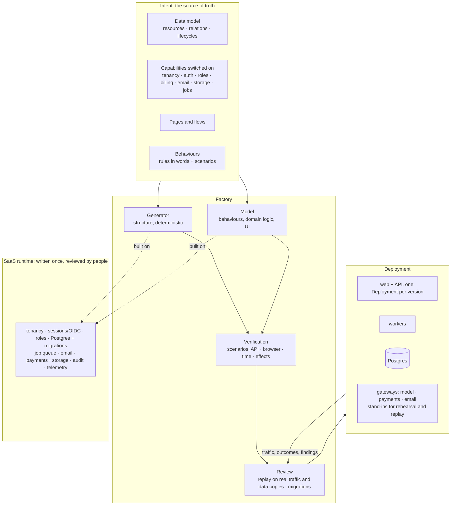

# Building a full SaaS from intent

The root idea is that software is built from intent: people say what they want, a precise spec is the source of truth, code is a cache generated from it, and behaviour (not code) is what's reviewed. A booking service, an incident tracker or a feature-flag service built that way proves the mechanism. The goal is bigger: **anything a real SaaS product does has to be viable in this system.** This document is the plan for getting there: the architecture, the decisions behind it, and the order it's being built in.

Booking for small businesses is the reference product that each phase must be able to produce. It's an example chosen because it touches nearly every SaaS capability (public pages, accounts, tenants, payments, reminder jobs, email, staff roles). Nothing in the factory may know about bookings.

## The design principle

No spec language can enumerate everything a SaaS does, so "anything is viable" can't mean "the spec has a field for everything". It means three things:

1. **Everything a SaaS needs is either a platform capability the intent switches on, or a behaviour the intent describes.** Capabilities are things that are the same everywhere and must be right: tenancy, sessions, roles, the database, jobs, outbound email and payments. Behaviours are everything particular to this product, stated in words and pinned down by examples, and written by a model.
2. **Everything is verified by behaviour, whatever kind it is.**
   - Examples become scenarios that drive the API, a real browser, time (jobs) and side effects (an email sent, a card charged), all observed through fakes.
   - The review replays real traffic against copies of real data.
   - Canaries judge real outcomes.
3. **Every effect on the world is reversible or held for a person.** Releases, migrations, charges and messages are all declared effects.

## Architecture

The four layers:

- **Intent.** The spec grows from records into a product:
  - a data model with real relations;
  - capabilities switched on and configured;
  - pages and flows;
  - behaviours, each a rule in words plus the scenarios that define it.
- **The factory.** The deterministic generator writes everything structural. A model writes what only words can state: domain logic now, and the UI later. The examples, the review and the canary judge both the same way.
- **The SaaS runtime.** Security-critical, everywhere-the-same code (tenant isolation, sessions, role checks, the database layer, jobs, payments) lives in a runtime library that generated apps are built on. People review it once, rather than a model regenerating it on every change. A model writes only domain code against it.
- **Deployment.**
  - Postgres, web and workers run as separate deployments, with each version in its own pods.
  - Every external service (Anthropic, payments, email) sits behind the gateway pattern the model gateway established: credentials and egress live outside the app, there's a budget, and a stand-in is used for rehearsals and replays.

## Decisions

| Decision | Choice | Why |
|---|---|---|
| Generated app stack | **Go API + TypeScript single-page app** | A modern front end from day one. The API stays the contract every scenario and replay runs against; the SPA is verified in a real browser |
| Dependencies | **The factory stays standard-library only. Generated apps may use a small, pinned, reviewed allowlist** served from an in-cluster module (and npm) cache | A real SaaS needs a Postgres driver, a payments SDK and a front-end toolchain. Pinning and review keep supply-chain risk bounded, and the sandbox still has no internet |
| Reference product | **Booking for small businesses** | It touches nearly every capability; it's an example, not the point |
| Pace | **Phase by phase**, each with a demo and CI, stopping for review before the next | Each phase changes what "built from intent" means; each gets looked at |

## Phases

| # | Phase | What becomes viable | Status |
|---|---|---|---|
| 1 | **Behaviours** | Logic stated in words: computed values, cross-record checks, custom operations, all pinned down by examples and written by a model on top of generated structure. Recorded model replies make it repeatable offline | **Done**: `cmd/bookings` |
| 2 | **Postgres and migrations** | A real database. Schema changes are reviewed like behaviour: expand/contract, both versions on one database, data read through both. The dependency allowlist and module cache arrive here | Next |
| 3 | **The SPA** | A TypeScript front end generated from the intent's pages and flows. Scenarios drive a real browser. The product owner signs off by using the built product before users see it | |
| 4 | **Identity** | Tenants, users, sessions (OIDC), roles; tenant isolation proven by scenarios that try to cross it | |
| 5 | **Time and effects** | Scheduled and background jobs, with time as an input scenarios control. Email and webhooks as reversible or held effects, observed by fakes | |
| 6 | **Integrations** | Payments and subscriptions, file storage, each through a gateway with a budget, a stand-in, and replay | |
| 7 | **One pod per version** | Each version in its own Deployment with its own volume; closes the sandbox's shared-volume gap. The reference product built entirely from intent | |

## Phase 1: what was built

The spec gained **behaviours**, which belong to a resource:

- **computed** sets a computed field, which callers can't set, on every write. Example: the booking's price, with a weekend surcharge.
- **check** may refuse a create or update with a status and a reason. Examples: no double-booking, opening hours.
- **action** is an operation beyond create, read, update and delete: `POST /<plural>/{key}/<action>`. It may change the record and answers with a result. Example: cancel, with a refund that depends on notice.

Each behaviour is a `rule` in plain language. The spec checker refuses any behaviour that no example names, because the examples are the only definition of right.

The **`BehaviourCoder`** splits the work. The generator writes `main.go`: types, storage, endpoints, validation, relations, lifecycles, access, and calls to fixed hooks. A model writes only `behaviours.go`, implementing those hooks against the generated code. It's sent the hooks, the examples that pin them, the spec and the generated code; on a retry, it also gets its previous file and exactly which examples failed. The generator alone refuses such a spec. A behaviour is the part only a model can write.

**The review understands behaviours.**
- A difference on real traffic is traced to the behaviour whose rule changed, by name: `behaviour opening_hours changed`.
- A refusal that's reworded is explained only if a check that runs on that operation changed.
- Behaviour that changes when the intent didn't is **drift**, and is flagged:
  - if an example pins it (a price), the build fails;
  - if nothing pins it (a refusal's wording), the review marks it unexplained.

**Recorded model replies make it repeatable.**
- `model.Recorder` saves each reply under the hash of the exact prompt.
- `model.Replayer` answers only those prompts, so a changed spec can't be answered by a stale recording.
- Offline runs and CI replay the recordings; a live run asks the model fresh, and `-record` saves new ones.
- The recordings in `cmd/bookings/recordings` were written by Claude for the exact prompts these specs produce.
- The rehearsal stand-in (`fakeclaude -recordings`) answers behaviour prompts the same way. So in kind, `run.sh rehearse bookings` exercises the whole path: gateway, sandbox, behaviour code.

**What phase 1 doesn't do yet.**
- **Time is an input.** A cancellation says when it happened. There's no clock or scheduler until phase 5.
- **Answers to behaviour findings are limited.** When a changed behaviour refuses production requests, the only answer offered is "keep refusing". Changing a rule in words is a conversation; there's no button for it yet.
- **Checks look at writes, not existing data.** A Sunday booking made before the rule changed still exists, and moving it would now be refused.
